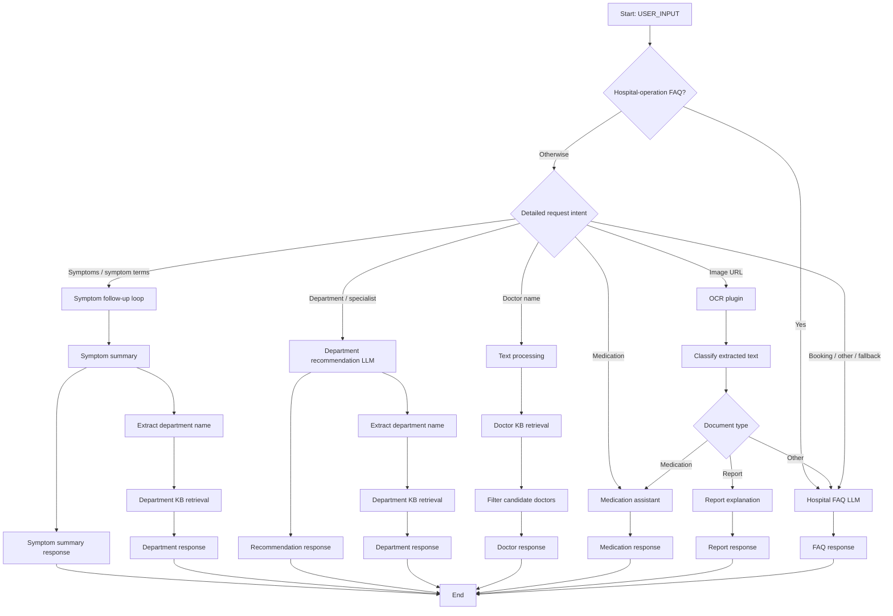
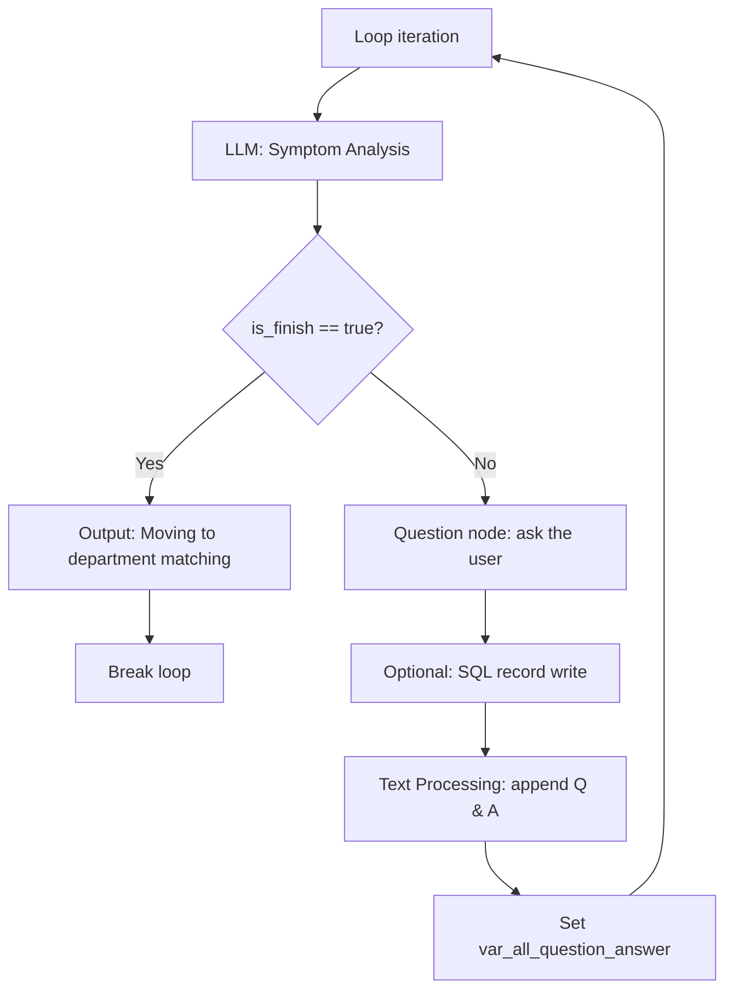

# Build the AI Pre-Consultation Chatflow from Scratch (Coze)

**Independent reconstruction guide — no ZIP/YAML import required.**

This guide describes how to manually create a **functional approximation** of the exported `daozhen` Chatflow in a new **Coze** workspace. It is based on the workflow structure observed in the provided export (28 top-level nodes, including a loop containing 8 inner nodes). It intentionally does **not** reproduce organization-specific hospital prompts, private resource IDs, or outdated links. The original knowledge bases and plugins are **not contained** in the export, so a byte-for-byte identical reproduction is not possible from public documentation alone.

> **Important: Coze platform required.** These instructions describe operations in the Coze visual workflow editor. They are **not** instructions for running the project in Python, Node.js, or another platform. Coze UI labels, node capabilities, and available models may differ by workspace/region/version. Where the sample uses a node that your Coze edition lacks, use its equivalent or document the difference.
>
> **Never use real patients or real clinical data** when following this public demo. All examples below are synthetic, and the system is not for clinical use.

## 1. Before you begin

Create or obtain the following **inside your own Coze workspace**:

| Resource | Used for | Minimal demo substitute |
| --- | --- | --- |
| Text LLM | Follow-up questions, summary, extraction, responses | Any available model supporting structured outputs or JSON |
| OCR / image-to-text plugin | Extract readable text from report images | A supported OCR plugin taking a public image URL |
| `HospitalFAQ` knowledge base | Location, process, appointment FAQ | 3–5 entirely synthetic FAQ entries |
| `DepartmentDirectory` knowledge base | Map department names to stable `dept_id` values | CSV or Markdown with demo IDs |
| `DoctorDirectory` knowledge base | Match doctor names to department/doctor IDs | 3–5 fictional doctor records |
| Coze database (**optional**) | Save Q&A records | Skip this node; keep conversation state only |

**Suggested synthetic knowledge files** (replace all values with data you are allowed to use):

`HospitalFAQ.md`:

```md
# Example Hospital — Demonstration FAQ
Q: Where is registration?
A: Follow the registration signage at the main reception desk.
Q: How do I make an appointment?
A: Ask the registration team or use the hospital's official booking channel.
Q: Where is the pediatric department?
A: Confirm the current location at reception; this demo has no live floor-plan data.
```

`DepartmentDirectory.csv`:

```csv
dept_id,dept_name,keywords
101,Pediatrics,"child,infant,fever,cough"
102,Orthopedics,"bone,knee,joint"
103,Dermatology,"skin,rash"
104,General Medicine,"general consultation,unclear symptoms"
```

`DoctorDirectory.csv` (**all names are made up**):

```csv
id,HOSPNAME,DEPTNAME,NAME
2001,Example Hospital,Pediatrics,Demo Doctor A
2002,Example Hospital,Orthopedics,Demo Doctor B
2003,Example Hospital,Dermatology,Demo Doctor C
```

Create those knowledge bases through the knowledge/data-management area supported by your Coze version. The original Chatflow references external dataset IDs; **copying those IDs will not recreate the content**. Do not claim that examples above represent any real hospital's current departments or staffing.

## 2. Create the Chatflow and start variables

1. Open Coze, create a new **Chatflow** (not a plain, non-chat workflow), and name it `AI Pre-Consultation and Triage`.
2. Keep the automatically supplied start fields:
   - `USER_INPUT`: `string` — the current text message (or an image URL for the OCR branch).
   - `CONVERSATION_NAME`: `string` — Coze conversation identifier when supplied by the platform.
3. Add an **End** node; eventually connect the terminal outputs from all branches to it.
4. Use a **test-only** dataset and never save a real person's health information while experimenting.

### Complete route plan

The following names are the **original conceptual branches**; you can choose clearer labels in your new workspace.



**Note:** The original export contains several parallel Output nodes (including both a symptom summary and a department-ID response). In a manual reconstruction, test how your Coze version handles multiple downstream outputs and format the final Chatflow response appropriately. Don't assume that two parallel outputs automatically combine into valid JSON.

## 3. Build the two intent-recognition stages

### Stage A — Hospital FAQ guard

Add an **Intent Recognition** node, `Hospital FAQ Intent`, with:

- **Query input**: `Start.USER_INPUT`.
- **Intent 0**: hospital information and administrative processes (opening hours, reception, department locations, payment, registration, insurance, appointment process).
- **Default**: all other requests.
- **Connection**: `Intent 0 → Hospital FAQ LLM`; `Default → Detailed Intent Recognition`.

The original stage uses no chat history for this first guard. This is a reasonable default to begin with.

### Stage B — Detailed intent classification

Add another **Intent Recognition** node with `query = Start.USER_INPUT`. The original uses up to **3 turns of chat history** for this second stage. Configure the following intents and connections:

| Original intent index | Examples / meaning | Connect to |
| --- | --- | --- |
| 0 | Symptom inquiry (“I have a cough, which department?”) | Follow-up Loop |
| 1 | Direct department (“Orthopedics”) | Department Recommendation |
| 2 | Request for a specialist (“Recommend a dermatologist”) | Department Recommendation |
| 3 | Additional symptom descriptions (“Occasional dizziness”) | Follow-up Loop |
| 4 | Symptom term only (“Convulsion”) | Follow-up Loop |
| 5 | Image/document URL | OCR |
| 6 | Medication use or medication name | Medication Assistant |
| 7 | Aesthetic surgery / skin-related department question | Department Recommendation |
| 8 | Appointment / registration request | Hospital FAQ LLM |
| 9 | “I want to register for department X” | Department Recommendation |
| 10 | Doctor name or “Dermatology + doctor name” | Doctor Lookup |
| Default | Unrecognized inquiry | Hospital FAQ LLM |

**Caution:** Intent 0, 3, and 4 intentionally overlap in the draft. If classification proves unstable, merge them into a single symptom intent when adapting the workflow. This is a recommended adjustment, not a claim about the exported wiring.

## 4. Build the adaptive symptom follow-up loop

Add a **Loop** node named `Symptom Follow-up`.

**Observed export settings:**

| Setting | Value |
| --- | --- |
| Loop mode | Count |
| Loop count | `3` |
| Internal string variable | `var_all_question_answer` |
| Initialization | Empty text (use `""` as the actual *empty value*, not literal quote characters) |
| Loop output | `all_question_answer = var_all_question_answer` |

**Mismatch in the original draft:** the LLM's prompt says **four** questions while the actual exported loop is set to **three** iterations. For this reproduction, use **three** as the limit in both places. A completed chat may use fewer than three questions when `is_finish` is true.

### Internal connections



If you skip SQL, connect `Question → Text Processing` directly.

### 4.1 LLM: Symptom Analysis

**Inputs**:

| Name | Type | Bind to |
| --- | --- | --- |
| `USER_INPUT` | string | `Start.USER_INPUT` |
| `var_all_question_answer` | string | `Loop.var_all_question_answer` |

**Outputs (structured fields; required):**

```json
{
  "question": "string",
  "is_finish": false
}
```

Configure a structured-output / JSON option in your Coze LLM node, and expose `question` as a **string** and `is_finish` as a **boolean**, not a text value such as `"false"`. If the selected model returns raw JSON text, parse/validate it before the condition node. A good starting model configuration is temperature around `0.7`, with a token limit sufficient for the prompt; the exact original model is not required.

**Copy-ready demonstration system prompt (Chinese):**

```text
你是一个用于原型演示的诊前信息收集助手，不是医生，也不能做出确诊或处方。

输入：
- 用户主诉：{{USER_INPUT}}
- 已有问答记录：{{var_all_question_answer}}

目标：从主诉、持续时间、伴随症状和重要危险信号中，找出当前最需要补充的1项信息。
要求：
1. 每轮只问一个口语化的问题，不要重复历史中已经回答的问题。
2. 优先明确症状何时开始、是否加重及重要伴随症状；不要一次要求填写整张问卷。
3. 如果目前信息足以形成初步就诊指引，或已有问答达到3个，则结束提问。
4. 当用户描述严重呼吸困难、意识改变、持续抽搐等紧急表现时，立即在对话中提示寻求急救帮助，不要继续常规问诊；实际系统需要单独测试并实现紧急分流。
5. 仅返回结构化字段：question（字符串）与 is_finish（布尔值）。
6. 需要继续时：is_finish=false，question=下一问。
7. 需要结束时：is_finish=true，question=""。
```

**User prompt:**

```text
用户原始描述：{{USER_INPUT}}
已记录问答：{{var_all_question_answer}}
请决定是否继续追问，并产生输出字段。
```

> The original prompt mentions emergency symptoms, but the exported graph does not contain a separate verified emergency-handling branch. The instructions above do not make the prototype safe for emergency triage. In a more complete design, add and test an explicit emergency-intent/alert branch **before** normal follow-up.

### 4.2 Condition: is_finish

Create one condition: `Symptom Analysis.is_finish == true`.

- **True** → Output node with the message `Information collected. Preparing a department suggestion...` → **Break Loop**.
- **Otherwise** → **Question** node.

Use the exact boolean field output. The question node may pause and wait for a user reply; in Coze this is different from merely printing a message.

### 4.3 Question node

- Question text: `{{Symptom Analysis.question}}`.
- Answer mode: text.
- Capture **`USER_RESPONSE`** (string) as an output.
- Bind the current question string to a node input if your editor requires it.

The source draft's question-node limit is 3. Align this with the loop setting when testing, rather than claiming the workflow can ask unlimited questions.

### 4.4 Optional SQL write node

The original graph connects `Question → SQL Custom → Text Processing`, inserting `(question, answer, date)` into a Coze-linked table. Its source SQL interpolates dialogue strings directly; **do not copy that SQL into a real system**.

For a public demo, **leave this node out**. If you later need persistence, use a database connector and parameterized operations supported by your platform, a minimal data model, consent, and a retention/deletion policy. A demo-friendly logical schema is:

```text
id | pseudonymous_session_id | question | answer | created_at
```

### 4.5 Text Processing: append question / answer

Configure a text-concatenation node with inputs:

- `String1 = Loop.var_all_question_answer`
- `String2 = Symptom Analysis.question`
- `String3 = Question.USER_RESPONSE`

Concatenation template (**same variable structure as the export**):

```text
{{String1}}
Question: {{String2}}
User: {{String3}}
```

Output: `output` (string).

### 4.6 Set Variable

Set `Loop.var_all_question_answer = Text Processing.output`, then connect **Set Variable → loop continuation**.

**Verify** that the next iteration receives the updated transcript. Also verify the loop can exit early when `is_finish` is true. The export's `all_question_answer` output comes from this mutable string variable.

## 5. Summarize symptoms and map to a department

**After** the loop (not inside it), add:

1. **LLM: Symptom Summary**, input `input1 = Loop.all_question_answer` and optionally a separate `initial_message = Start.USER_INPUT` (recommended so the chief complaint is not lost).
2. **LLM: Extract Department Name**, input `input = Symptom Summary.output`.
3. **Knowledge Retrieval: Department Directory**, query = `Extract Department Name.output`.
4. **Output**: a human-readable symptom/next-step summary; optionally a separate structured department-ID payload.

**Symptom Summary prompt:**

```text
你是用于教学演示的诊前信息整理助手。根据用户主诉与已经采集的问答，整理：
1. 主诉与症状持续时间
2. 关键伴随症状
3. 仍不明确的信息
4. 可供就诊咨询的科室类别（不得冒充医院实时挂号结果）
5. 危险信号提醒与建议寻求专业评估的情形
不得把可能性写成确诊，不提供处方。
请用结构清晰、患者能理解的中文输出。
```

**Extract Department Name prompt:**

```text
从上一条就诊建议中提取一个最合适的科室名称。
只输出科室名，不能输出解释、Markdown或多个候选值。
如果无法判断，输出“全科医疗科”。
```

In the source export, each department lookup uses a Coze Knowledge Retrieval node with **topK=5** and, in two of the nodes, a **minimum score of 0.5**. Adjust these values to fit your own demo dataset. **Keep the department `dept_id` from the data**, not an ID invented by the model.

**Optional machine-readable result** (illustrative record values only):

```json
{
  "dept_id_1": [101],
  "un_type_json": "dept"
}
```

The exported Output nodes use a template of the form `{"dept_id_1":[{{output}}],"un_type_json":"dept"}`. That only forms valid JSON if `output` is a correctly formatted list of IDs; a raw knowledge-retrieval document is **not** automatically valid here. Normalize and validate retrieved `dept_id` data before constructing the payload.

## 6. Direct department recommendation branch

Create **LLM: Department Recommendation** with input `Start.USER_INPUT`, followed by:

- **Output** of a readable recommendation; AND
- **LLM: Extract Department Name** → **DepartmentDirectory KB retrieval** → **Output** of a validated `dept_id` payload.

**Recommended demonstration prompt:**

```text
你是一个医院导诊信息助手。用户可能输入症状、一个科室名称，或希望找到某领域的医生。
请用简洁中文给出一个合适的就诊科室类别，并用1至2句话解释理由。
如果原始信息不足，请说明不确定性；如有紧急危险信号，提示寻求紧急医疗帮助。
不要声称已经挂号成功、医生有号、或者已经确诊。
```

This is intended for **department-level guidance**, not verified doctor availability.

## 7. Doctor lookup branch

Original wiring: **Text Processing → Knowledge Retrieval → LLM → Output**.

1. **Text Processing**: combine a generic hospital label and `Start.USER_INPUT` to focus a search. For a portable demo, use:

   ```text
   Example Hospital {{USER_INPUT}}
   ```

2. **Knowledge Retrieval**: connect `DoctorDirectory` and set `Query = Text Processing.output`. In the source export, the doctor-directory retrieval uses `topK = 5`, with reranking and query rewriting enabled.
3. **LLM: Doctor Filter**, inputs:
   - `input = Doctor Retrieval.outputList`
   - `USER_INPUT = Start.USER_INPUT`
4. **Output**: valid JSON only; if there are no supported records, return an empty list.

**Doctor Filter prompt:**

```text
你负责从给定的医生记录中筛选匹配项，不得编造医生、科室或ID。
记录字段：id、HOSPNAME、DEPTNAME、NAME。
根据用户提供的医生姓名、科室及医院筛选。
必须以检索结果为唯一依据；如果无匹配记录，返回空列表。
只输出有效JSON，格式为：
{"list":[{"id":2001}],"un_type_json":"doctor_list"}
不要加注释、Markdown或额外字段。
```

**Example fallback:**

```json
{"list":[],"un_type_json":"doctor_list"}
```

## 8. Medication assistant branch

Create **LLM: Medication Assistant** and connect it to the **Medication intent**; the image branch can also route to this same assistant after OCR indicates medication-related text.

- `input = Start.USER_INPUT`
- `data = OCR.data` **only when this path has produced OCR output**. In a manual rebuild, make this optional or create separate text-only and OCR-input branches; otherwise a missing OCR result may break the text-only route.

**Demo prompt:**

```text
你是药品说明信息辅助阅读工具，仅用于学习和就医前准备。
解释药品名称、说明书常见字段及需要向药师确认的问题。
没有可靠来源或信息不完整时，明确表示无法核实。
不要给出个体化处方、危险剂量、擅自停药建议或未经核实的疗效保证。
如涉及儿童、妊娠、过敏、严重不良反应或相互作用，请建议咨询医生或药师。
```

The exported node refers to additional plugin/search resources through Coze-specific identifiers. Those tools may not exist in your account; the manual demo does **not** require them. Do not claim internet verification unless an authorized source is actually connected.

## 9. OCR and report-image branch

The observed route is:

```text
Image request → Image2text/OCR plugin → Document Type LLM → Condition
                                                    ├─ 报告类型 → Report Explanation LLM → Output
                                                    ├─ 药品类型 → Medication Assistant → Output
                                                    └─ 其他类型 → Hospital FAQ LLM → Output
```

### 9.1 OCR plugin

- Choose an image-to-text/OCR plugin available in your Coze workspace.
- Bind its required `url` input to a **direct, accessible image URL**, not arbitrary unparsed user prose.
- The original export directly connects `Start.USER_INPUT` to the OCR `url` field. If your user interface passes Markdown (``), JSON, or an internal file object instead, add **URL extraction / normalization** before this node.
- A common output shape is nested data such as `data.results[*].words[*].text`. Different OCR plugins may return a different schema; inspect a sample result in Coze before wiring downstream inputs.
- If the image URL expires or permission checks fail, show an understandable error and ask for a new image.

### 9.2 Document type LLM

Input = extracted OCR text (`OCR.data`, or the cleaned joined text values).

**System prompt:**

```text
请识别OCR提取的文本属于哪一类，只返回以下一个标签：
报告类型
药品类型
其他类型

有检验项目、参考范围、检查结论或体检指标的，优先判断为“报告类型”。
有药品名称、成分、适应症、用法或说明书内容的，判断为“药品类型”。
无法判断时返回“其他类型”。
只输出标签，不输出解释、标点或Markdown。
```

Connect a **Condition/Selector** node with exact string matches on the output:

- `== "报告类型"` → Report Explanation
- `== "药品类型"` → Medication Assistant
- `== "其他类型"` OR default → Hospital FAQ / Unsupported Document fallback

### 9.3 Report explanation LLM

Bind its input to extracted OCR text, preferably a plain-text concatenation of recognized lines rather than a raw nested object.

**System prompt:**

```text
你是用于演示的检验报告文字解释助手。收到的是OCR提取的文本，不应假设图像识别完全准确。
请：
1. 识别看起来像报告名称、检查项目、结果值、单位和参考区间的字段。
2. 仅在数值、单位、参考区间都能清晰读取时，描述可能的异常项目。
3. 对无法识别的字段或不完整参考范围，明确提示无法判断，不要补造数值。
4. 按“识别到的信息 / 可能需要关注的项目 / 给医生的问题”组织回答。
5. 不做确诊，不给个体化治疗或用药剂量建议；严重症状应建议及时就医。
```

Example response headings: `Extracted values`, `Possible out-of-range items`, `Questions to ask a clinician`. This is **OCR-assisted interpretation**, not native multimodal vision reasoning unless you explicitly introduce a separate vision model.

## 10. Hospital FAQ branch

Create **LLM: Hospital FAQ** (or connect a retrieval node and then an LLM, depending on your Coze version).

- Input: `Start.USER_INPUT`.
- Authorized resource: your own `HospitalFAQ` knowledge base.
- Output: a short answer that is **grounded in the loaded FAQ**.

**Prompt:**

```text
你是 Example Hospital 的信息助手，只回答医院地点、就诊流程、挂号与常规办事咨询。
请优先依据已配置的医院FAQ资料作答。
如果资料中没有答案，请明确说明当前无法核实，建议查询医院官方渠道。
不要编造院区地址、楼层、挂号时间、医生出诊安排或预约链接。
涉及症状、用药或检查的问题，不得将行政FAQ答案当作医疗建议。
```

The original draft embeds Coze-specific knowledge-block references inside an LLM prompt; you must **reattach your own resources** when rebuilding.

## 11. Output nodes, terminal wiring, and response formats

The Coze export uses multiple **Output** nodes. Recreate one output per final branch and connect every terminal output to the **End** node:

| Branch | Visible output |
| --- | --- |
| Symptom follow-up | Symptom summary and, if data is available, department mapping |
| Department inquiry | Human-readable recommendation and optional department ID |
| Named doctor lookup | Filtered fictional/demo records, or empty list |
| Medication inquiry | General explanatory response |
| OCR report | Explanation with uncertainty and limitations |
| Hospital FAQ / fallback | Grounded operational answer or “cannot verify” |

**Important:** A human-readable Markdown answer and a JSON protocol response serve different clients. If one consuming app expects strict JSON, add a final normalization/validation step instead of outputting overlapping free text and JSON from parallel nodes.

## 12. Rebuild verification checklist

Test with *synthetic* inputs after wiring each branch; the following describes **expected behavior to test**, not results already demonstrated by the uploaded workflow.

| Test | Example message | What to verify |
| --- | --- | --- |
| Symptom loop | `孩子夜间咳嗽三天` | Asks one relevant question at a time; Q&A state persists; reaches summary |
| Loop stop | Give sufficient symptom details early | `is_finish=true` ends without an extra question |
| Hard limit | Keep answering briefly | No more than 3 configured follow-up iterations |
| Department | `我应该挂骨科吗？` | Correct branch; no invented booking confirmation |
| Doctor lookup | `找Demo Doctor B` | Searches only synthetic records; returns the matching `id` or empty list |
| Medication | `这个药说明书怎么看？` | Explains limits and does not invent dosing |
| OCR report | Pass an authorized sample report image URL | OCR text reaches type classifier and then report branch |
| OCR medication | Pass a sample medication leaflet URL | Branches to medication assistant |
| OCR failure | Broken/expired/unauthorized URL | Error message and safe fallback, not fabricated text |
| FAQ | `挂号应该去哪里？` | Uses sample hospital knowledge and distinguishes unknown facts |
| Nonmedical | `给我写一首歌` | Safe fallback rather than fake medical advice |
| Critical symptom | `突然意识不清` | Explicit emergency routing/response; do not claim safety without testing |
| Storage off | Disable SQL node | Question loop still completes without database access |
| JSON output | Named doctor / department ID | Parse returned payload; reject invalid JSON and invented IDs |

### Known gaps in the exported draft to address

1. **Loop-count mismatch:** graph limit 3 vs. prompt wording mentioning 4 questions.
2. **Hospital-name inconsistency:** multiple institutions appear in original prompt examples; normalize all prompts and datasets to **one authorized, synthetic organization**.
3. **Nonportable dependencies:** original plugin, database, and knowledge-base IDs will not automatically resolve in a separate Coze workspace.
4. **Possible missing input:** a text-only medication route references OCR data even though OCR is not always on that path.
5. **Unverified retrieval-to-JSON conversion:** returned knowledge snippets should not be inserted into a machine-readable `dept_id` field without parsing and validating IDs.
6. **SQL safety and data governance:** avoid directly interpolating user-controlled text in database queries; avoid storing real patient information.
7. **No confirmed integrated clinical testing:** branch wiring and prompts are a design export, not evidence of a clinically reliable or deployed service.

## 13. What is and is not reproduced

**Reproduced from the exported design:** two-stage intent routing, a 3-count symptom loop with Q&A accumulation, symptom summary, department extraction and knowledge retrieval, named-doctor lookup, medication FAQ, OCR text extraction, report-vs-medication classification, and terminal outputs.

**Adapted for portability/safety:** all hospital-specific names and links, copy-ready public demonstration prompts, synthetic KB examples, SQL made optional, structured-output validation advice, and explicit medical/privacy limitations.

**Not included:** real hospitals' private data, live appointment systems, external APIs tied to another Coze account, a deployable non-Coze backend, measured accuracy, integration test results, or medical clearance.

Return to the **[project README](../README.md)**.
