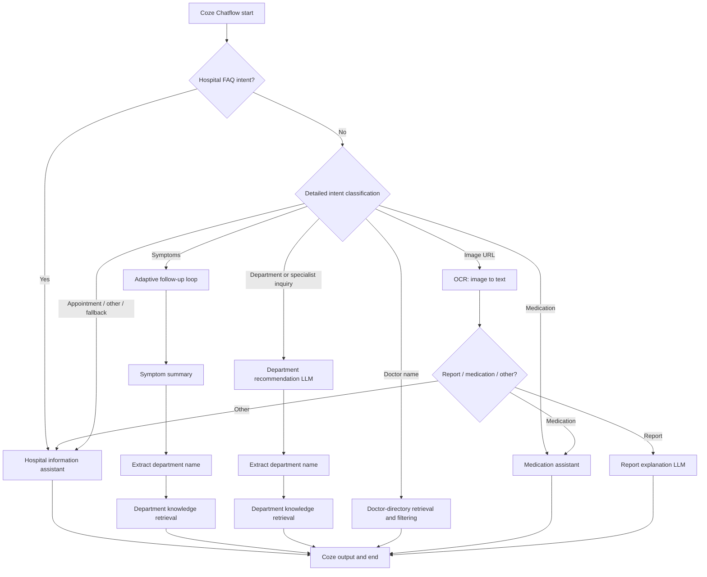

# AI-Assisted Pre-Consultation & Hospital Triage

**A Coze Chatflow prototype for conversational symptom collection, department routing, hospital information retrieval, and OCR-assisted document interpretation.**

> **Platform requirement — Coze only.** This project is a **Coze Chatflow definition**, not a standalone Python/JavaScript application. Its native workflow uses Coze's nodes, model configuration, conversation handling, plugins, and knowledge bases. **You need access to Coze to run or rebuild it.** Downloading the YAML or cloning this repository will **not** make it executable outside Coze. Reimplementing the same logic in LangChain, Dify, n8n, or another framework would be a separate development project.
>
> **Status:** Prototype / workflow design. A Chatflow export exists, but complete end-to-end integration, deployment, and clinical validation have **not been established**.

## Overview

The goal is to explore how an AI-based conversational interface could guide someone through a **pre-consultation information-gathering** journey instead of returning a single generic response. The workflow selects a response path based on the user's request, asks relevant follow-up questions when more symptom details are needed, and prepares an understandable summary or routing recommendation.

The exported design covers **general hospital triage scenarios, including pediatric symptom-related questions**. It is not a pediatric-only or clinically validated diagnostic system.

### What the prototype includes

| Capability | Workflow mechanism | Important limitation |
| --- | --- | --- |
| Intent-based routing | Two intent-classification stages | Intent categories overlap; routing requires testing |
| Adaptive symptom follow-up | LLM + conditional branch + question node + loop state | Exported loop limit is 3; prompt wording mentions 4 questions |
| Symptom summary & department suggestion | LLM summarization + department extraction + retrieval | Requires a configured local department directory |
| Direct department inquiries | LLM recommendation + knowledge-base lookup | Not a live appointment-booking integration |
| Doctor lookup by name | Text processing + knowledge retrieval + LLM filtering | Requires hospital-specific doctor records |
| Medication questions | Medication-assistant LLM; optional tools | Educational information only; not prescribing |
| Report-image input | Coze OCR plugin + document-type classification | OCR processes readable text; it is not a general vision model |
| Report interpretation | LLM response from OCR-extracted values | OCR and medical interpretation can both be wrong |
| Hospital FAQ | FAQ-oriented LLM and platform knowledge resources | Original referenced datasets are not included in the export |
| Optional record writing | SQL node inside the follow-up loop | Requires a separately configured database and privacy controls |

## Workflow architecture



**Inside the follow-up loop:** the model produces `question` and `is_finish`; a condition either asks the user another question or terminates the loop. The user's response is appended to a running `question / answer` transcript through a text-processing node and a set-variable node. The exported workflow also places an SQL-write node in this path; that is **optional for a reconstructed demo**.

## Repository contents

```text
.
├── README.md                    # Project overview, platform requirements, build map
├── MANIFEST.yml                 # Coze export manifest (if shared)
├── workflow/
│   └── daozhen-draft.yaml      # Coze-native Chatflow definition (if shared)
└── docs/
    └── BUILD_FROM_SCRATCH.md   # Step-by-step manual Coze reconstruction
```

The `MANIFEST.yml` and `workflow/daozhen-draft.yaml` files are the names inside the original Coze export. **This README does not require them to be present**: the guide below describes how to build a functionally similar workflow manually. The exported files should only be uploaded if you are authorized to publish them and have removed organization-specific/private configuration.

## Requirements

- A **Coze workspace** with access to **Chatflow / Workflow** creation and supported LLM nodes.
- Models capable of **text classification, summarization, and structured fields** (the originally selected model versions may no longer be available).
- An **OCR/image-to-text plugin**, or an equivalent plugin that accepts an image URL and returns extracted text.
- Your **own authorized hospital FAQ, department directory, and doctor directory**, uploaded to Coze knowledge bases.
- **Optional:** a Coze-compatible database to save demonstration question/answer records. You can omit this step and keep the loop working without persistence.

**No `pip install`, `npm install`, `python main.py`, or Docker command is provided** because the exported project does not contain a standalone executable application.

## Rebuild it manually in Coze (no import required)

The complete copy-ready node instructions, prompt templates, variable bindings, routing table, example data schemas, and tests are in **[Build from scratch: Coze Chatflow](docs/BUILD_FROM_SCRATCH.md)**. You do **not** need the ZIP/YAML to follow that guide, but you **do** need Coze and must supply your own model/plugin/data resources.

**Minimal build sequence:**

1. Create a **new Chatflow** in Coze. Use its built-in `USER_INPUT` and `CONVERSATION_NAME` start variables.
2. Add a first **Intent Recognition** node that separates hospital-operational FAQ from all other requests.
3. Add a second **Intent Recognition** node for symptom, department, doctor, medication, image, and fallback requests; connect each intent to the corresponding branch.
4. For symptoms, add a **Loop** with a string state variable `var_all_question_answer`, initialized to an empty string, and a loop limit of **3**.
5. Inside the loop connect: **LLM (structured `question` / `is_finish`) → Condition → Question → [optional SQL] → Text Processing → Set Variable → next iteration**. The `is_finish = true` path should **end the loop**, not ask another question.
6. After the loop, connect **Symptom Summary → Department Name Extraction → Department Knowledge Retrieval → Output**.
7. Add separate **Department Recommendation**, **Doctor Lookup**, **Medication Assistant**, and **Hospital FAQ** branches.
8. For image requests, connect **OCR → Type Classification → Condition**, then route recognized reports, medication information, and unrelated/unknown text to separate handlers.
9. Connect all visible replies through **Output** nodes and each terminal path to the Chatflow **End** node.
10. Populate the knowledge bases, choose models available in **your Coze account**, configure an OCR plugin, and run the test scenarios in the detailed guide. Do **not** treat the diagram or example prompts as clinical validation.

The step-by-step guide distinguishes **settings observed in the exported design** from **recommended adjustments** for a safer, more portable reproduction.

## Input and output examples

**Example input — symptom inquiry**

```text
My child has been coughing at night for three days.
```

**Intended interaction** (illustrative; not a recorded test result):

```text
Assistant: Has the child had a fever or difficulty breathing?
User: No fever, but the cough gets worse at night.
Assistant: ... [another relevant question if needed]

Summary: Presenting concern, duration, associated symptoms, red flags discussed.
Suggested next step: Appropriate department for an in-person evaluation.
```

**Example input — department request**

```text
Which department should I visit for knee pain?
```

**Example input — report photo**

```text
A publicly accessible or temporary image URL passed to an OCR plugin.
```

Text extraction and any subsequent explanation require successfully configured external resources. Actual outputs vary by model, available knowledge, and workflow configuration.

## Project limitations & responsible use

- **Coze-dependent:** workflow exports are platform-specific and may depend on the version of the Coze editor.
- **Not plug-and-play:** dataset IDs, plugin IDs, database bindings, and organization-specific resources in the original export do **not** automatically transfer between accounts.
- **No live hospital integration confirmed:** department suggestions and example output formats should not be interpreted as verified availability, registered doctors, or confirmed appointments.
- **Data-quality issues in the draft:** the original prompts mention **more than one hospital** and use inconsistent wording for the follow-up limit. Rebuilders should replace those values with a single authorized test organization and reconcile the count before testing.
- **OCR and LLM outputs are fallible:** the project cannot diagnose disease, interpret reports reliably for treatment, prescribe medication, or replace a clinician or emergency services.
- **Privacy first:** do not upload real patient images, names, symptoms, reports, credentials, organization-only URLs, or identifiable consultation logs to a public repository or unapproved services.
- **Security review needed:** the draft SQL step constructs statements from dialogue fields. A real deployment must use safe parameter handling, access controls, consent, and an appropriate data-retention policy.

## Development status

- [x] Coze Chatflow design and exported prototype
- [x] Intent routing and separate task branches defined
- [x] Symptom follow-up loop and accumulated Q&A state defined
- [x] OCR and knowledge-resource connection points defined
- [ ] Reconcile draft configurations and remove organization-specific references
- [ ] Confirm cross-account import/reconstruction on a clean Coze workspace
- [ ] Complete end-to-end integration and error-path testing
- [ ] Perform expert review, privacy assessment, and clinical validation before any real-world use

## Purpose

This repository is an **AI product / conversational workflow design portfolio project**, illustrating **intent routing, conversational state, conditional logic, retrieval-augmented responses, and human-in-the-loop information collection** within Coze.

**Disclaimer:** Educational demonstration only. Not medical advice, a medical device, or an operational hospital service.

**License:** No license is declared here. This README does not grant rights to third-party Coze exports, datasets, prompts, or plugins.
